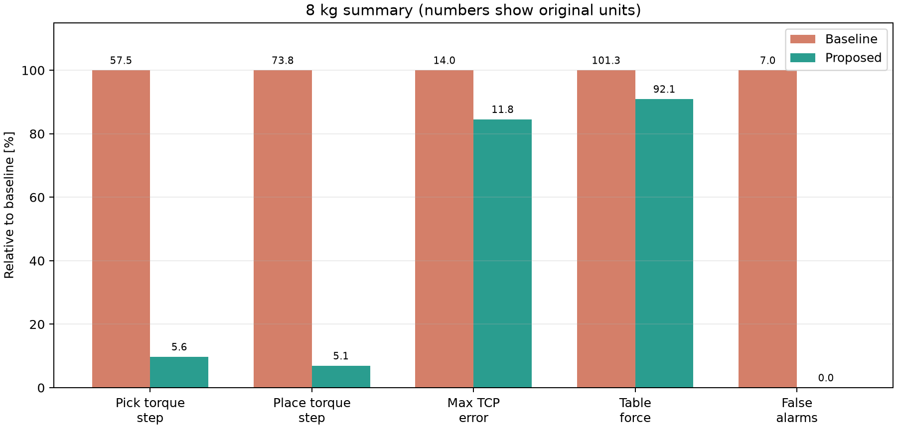
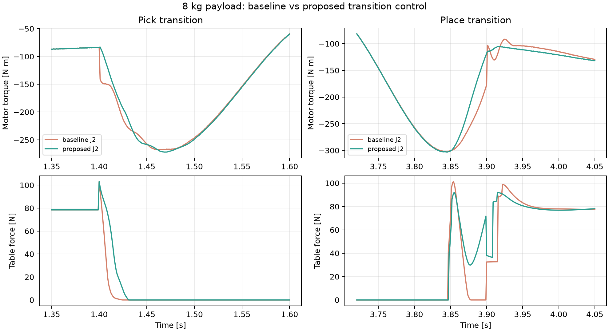
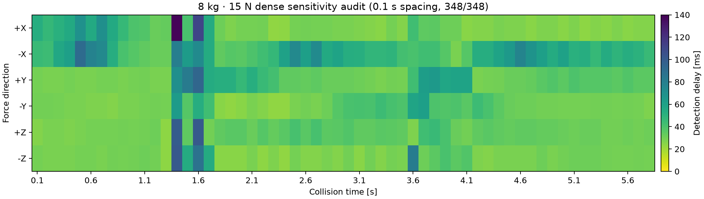
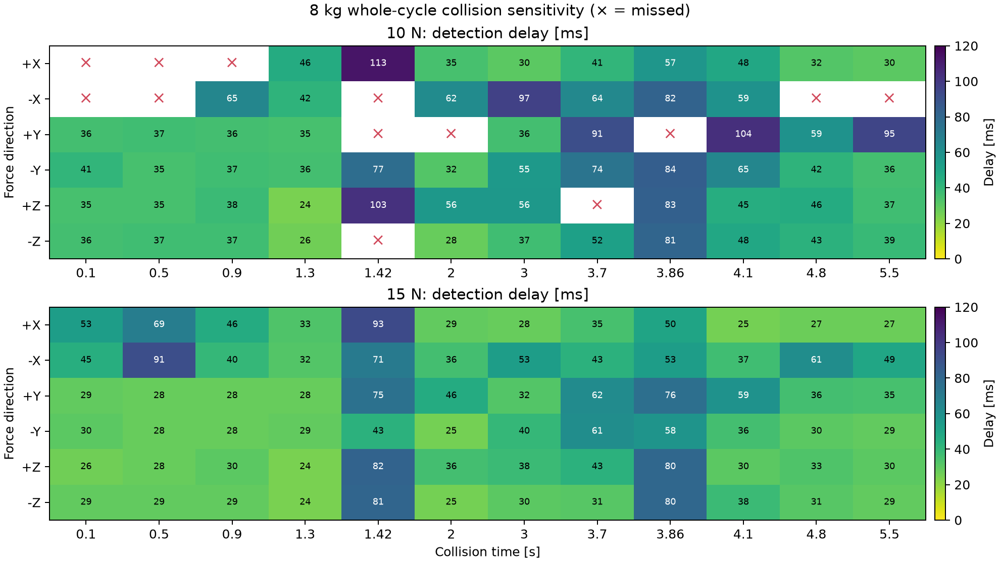
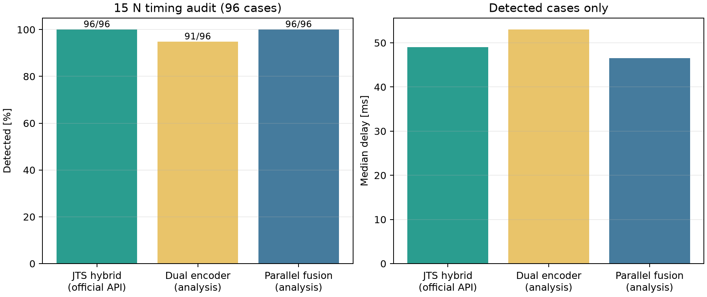
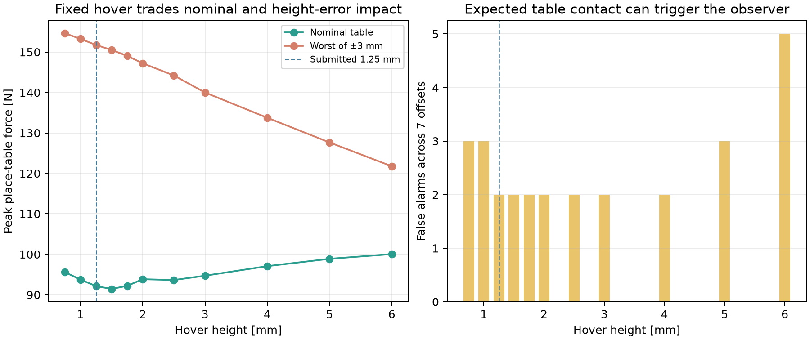

# IC-PBL 하중 천이 제어·충돌 감지 개선 보고

## 1. 결론

기준 제어기는 `grip` 신호 순간에 빈손 모델과 100% 하중 모델을 계단 전환한다.
제안 방안은 이를 **연속 하중 스케줄 + 미세 호버 궤적 + 상태별 혼합 충돌
관측기**로 바꾼다. 공개 평가에서 8 kg 기준 토크 계단을 집기 57.5 → 5.6
N·m, 놓기 73.8 → 5.1 N·m로 줄였고, 충돌 오감지는 7 → 0회로 줄였다.
집기 직후와 놓기 직전의 15 N 충돌도 ±X/±Y/±Z 전 방향에서 구분했다.
기준 궤적의 6초 사이클과 1 kHz 제어 주기는 늘리지 않았다. 즉, 전체 동작을
천천히 만드는 방법으로 문제를 숨기지 않고 같은 택트 안에서 천이만 다뤘다.



## 2. 논문에서 가져온 원리와 이 과제에서의 변형

1. **운동량 관측기** — Haddadin, De Luca, Albu-Schäffer의 충돌 감지
   서베이는 내부 센서와 동역학 모델로 외력 잔차를 만드는 방법을 정리한다.
   제공된 기준 감지기와 제안 감지기의 기반이다.
   [저자 공개본](https://iris.uniroma1.it/retrieve/e383532a-2aa9-15e8-e053-a505fe0a3de9/Haddadin_Postprint_Robot-Collisions_2017.pdf)
2. **페이로드 동역학의 선형성** — Gaz와 De Luca는 페이로드가 로봇 동역학
   계수에 만드는 변화가 선형이라는 점을 이용해 하중 파라미터를 추정하고
   충돌 감지를 개선했다. 이번 과제에서는 질량과 COM을 이미 아니까, 빈손과
   완전 하중 모델 사이를 현재 하중률 `alpha`로 보간한다.
   [저자 공개본](https://www.diag.uniroma1.it/~labrob/pub/papers/IROS17_PayloadEstimation_2199.pdf)
3. **접촉 전 선제적 충격 저감** — Arita 등은 접촉 전에 운동을 바꾸고 접촉
   임피던스 제어로 부드럽게 연결하는 방법을 제시한다. 이번 구현은 추가 센서
   없이 기준 궤적의 알려진 놓기 시각을 사용해 1.25 mm 호버 후 release한다.
   [저자 공개본](https://arxiv.org/abs/2212.03545)
4. **두 엔코더 기반 외력 추정** — Wan 등은 모터측·링크측 엔코더의 위치
   차이와 등가 관절강성으로 외력 토크를 추정하고 운동량 관측기와 결합했다.
   현재 과제 공식 콜백에는 링크측 값이 없으므로 제출안이 아닌 분석 확장으로
   재현했다.
   [논문 페이지](https://qikan.cmes.org/jcyyy/EN/10.3969/j.issn.1001-3881.2023.15.013)
5. **변동 페이로드 적응형 충돌 감지** — Chen 등은 관절가속도 없이 일반화
   운동량으로 미지 페이로드를 온라인 추정하고, 갱신된 모델의 운동량 관측기에
   일정 임계값을 적용했다. 현재 과제는 질량·COM을 안다는 가정을 쓰지만,
   현장 확장의 가장 직접적인 후속 방법이다.
   [논문 페이지](https://doi.org/10.1177/01423312241239375)
6. **모델 불확실성과 시변 임계값** — Jia 등은 위치·전류 측정과 비선형 확장
   상태 운동량 관측기, 데이터로 정한 시변 임계값을 결합해 민감도와 잡음
   강건성의 절충을 다뤘다. 이번 구현의 상태별 임계값과 사전 센서 교정은 더
   단순한 결정론적 대응이다.
   [논문 페이지](https://doi.org/10.1016/j.mechatronics.2021.102603)
7. **DLR-III의 고전적 운동량 충돌 검출** — De Luca, Albu-Schäffer,
   Haddadin, Hirzinger는 고유감각 센서만으로 일반화 운동량을 감시하고 탄성
   관절까지 확장했다. 수업 녹취에서 언급한 DLR 사례와 가장 직접적으로
   연결된다. 이번 구현의 정상 구간 관측기와 latch의 출발점이다.
   [DLR 논문 페이지](https://elib.dlr.de/45618/)
8. **모터각에서 링크각 복원** — Haddadin, Albu-Schäffer, Hirzinger의 DLR
   안전 연구는 링크측 위치센서보다 모터측 위치가 정확한 조건에서 유연관절
   모델을 사용해 링크 위치·속도를 추정했다고 설명한다. 이번 제출안의
   `q≈theta-tau_s/K` 복원은 같은 계열의 선택이며, 출력측 엔코더를 직접 쓰는
   확장안과 구분된다.
   [공개 PDF와 서지정보](https://elib.dlr.de/62490/)
9. **JTS 없는 모터전류 기반 검출의 마찰 문제** — Park 등은 모터전류와
   동역학 모델만 쓰는 검출에서 소산 마찰 모델의 정확성이 필요하다는 문제를
   학습 기반 SVM/CNN으로 다뤘다. 이 과제에서 `tau_m-tau_s` 원시 차를 쓰지
   않은 이유와, 전류만 쓸 때 별도 마찰 보상이 필요하다는 결론을 뒷받침한다.
   [IEEE DOI](https://doi.org/10.1109/LRA.2020.3033269)

논문의 방법을 그대로 복사한 것은 아니다. 특히 다음 두 항목은 이 과제 조건에
맞춘 제안이다.

- 집기와 놓기 구간에서만 잔차의 **알려진 페이로드 토크 방향 성분**을 따로
  다루고, 운반 중에는 원래 전체 잔차를 사용한다.
- 빈손 관측기에서 정상 하중이 만들 잔차를 같은 1차 관측기 동특성으로 예측해
  병렬 방향 충돌까지 남긴다. 충돌을 한 번 감지하면 안전 reset 전까지 latch한다.

## 3. 제어기

### 3.1 연속 하중 스케줄

하중 모델은 다음과 같이 보간한다.

\[
\tau_{ff}=\tau_0+\alpha(t)(\tau_{box}-\tau_0)
\]

집기에서는 25 ms smoothstep으로 `alpha: 0 → 1`을 만든다. 놓기에서는 기준
데이터의 질량별 조기 접촉 시각을 단순 선형화해 `grip OFF`보다 약 43~53 ms
먼저 `alpha: 1 → 0`을 시작한다. 공개되지 않은 질량에서도 값이 연속이다.

### 3.2 놓기 미세 호버

놓기 전에 TCP의 Z 위치 지령을 1.25 mm 올린다. 자코비안 의사역행렬로 관절
오프셋을 계산하고, release 뒤 부드럽게 기준 궤적으로 복귀한다. 8 kg에서
작업대 최대 힘은 101 → 92 N으로 감소했다. 5~20 mm처럼 높이를 과도하게
올리면 낙하 충격이 다시 커지는 것도 확인했다.



## 4. 충돌 감지기

감지기는 관측기 두 개를 병렬로 유지한다.

- **정상 운반 구간:** `grip` 상태에 맞춘 기존 운동량 관측기. 전체 잔차를
  사용하므로 충돌 방향을 제한하지 않는다.
- **집기·놓기 구간:** 빈손 관측기 잔차를 페이로드 토크 방향과 직교 방향으로
  분해한다. 정상 하중 잔차의 예상값을 빼고 남은 병렬 오차와 직교 잔차를
  결합한다.

하중이 처음 전달되는 짧은 구간에는 큰 천이 임계값을 쓰고, 관측기 응답이
가라앉은 뒤에는 낮은 정착 임계값으로 전환한다. 덕분에 최초 충격에는 경보하지
않으면서 뒤이어 들어오는 작은 충돌은 감지한다.

관측기 기동 50 ms 뒤부터 집기 직전까지 설계 JTS 영점 대비 최근 5 ms 평균
변화를 감시한다. 변화가 크면 그 샘플을 영점 기준선에 넣지 않고 충돌 증거로
사용한다. 무작위 감사에서 0.872 s 충돌이 교정 평균에 흡수되어 161 ms 늦게
검출되는 실패를 발견했고, 이 보호 로직으로 같은 조건을 22 ms에 검출했다.

관절별 임계값은 자세에 따라 같은 외력이 서로 다른 관절토크로 투영되는 한계가
있다. 그래서 집기·놓기 천이와 접근 감속이 끝난 안정 구간에는
`tau_ext = J_v^T f`를 최소제곱으로 풀어 Cartesian 힘 잔차도 병렬로 검사한다.
5 ms 평균이 8.5 N을 넘을 때만 증거로 쓰며, 교정에서 J2 잡음이 큰 경우에는 이
보조 판정을 끈다. 천이 구간은 정상 힘 잔차가 약 20 N까지 올라가므로 기존
상태별 관절 판정만 사용한다.

따라서 하중 전달 자체는 모델로 설명하면서, 같은 구간의 수평 충돌은 잔차로
남는다. 가상 로봇의 작업대 힘·실제 충돌력·실제 링크 상태는 감지 입력으로
사용하지 않았다.

### 4.1 센서 채널과 두 축의 의미

수업 녹취 55:51–57:34에서 말한 앞뒤 두 센서는 전류 센서 두 개가 아니라
모터측·링크측 엔코더이며 JTS는 별도 신호다. 과제 콜백이 직접 주는 값은
모터측 엔코더 `th`, 그 차분 속도
`thd`, 출력측 관절 토크센서 `tau_s`, 직전 주기에 적용된 모터토크 상당값
`tau_m`이다. `tau_m`은 실기에서 전류 기반 토크에 대응하지만 이 키트는 전류의
전기 모델을 따로 계산하지 않는다. 시뮬레이터의 2질량계에는 링크각 `q`도
존재하지만 현재 학생
콜백에는 직접 전달되지 않는다.

| 채널 | 물리적 의미 | 제어기 `compute` | 감지기 `update` | 비고 |
|---|---|:---:|:---:|---|
| `th` | 모터/입력측 엔코더 각도 | O | O | 18-bit 양자화 |
| `thd` | `th`의 1 ms 후진차분 속도 | O | O | 별도 속도센서가 아님 |
| `tau_s` | 링크/출력측 JTS 토크 | O | O | 잡음·오프셋·드리프트·1주기 지연 포함 |
| `tau_m` | 직전 주기 적용 모터토크 상당값 | X | O | 실기 전류토크 대응, 출력축 전류가 아님 |
| `q` | 링크/출력측 각도 | X | X | 시뮬레이터 내부·대시보드 분석 채널 |
| `q_d, qd_d, qdd_d` | 목표 각도·속도·가속도 | O | X | 실제 측정 상태가 아님 |

따라서 “입력축 전류와 출력축 전류” 두 개를 센싱하는 구조는 아니다. 전류로
환산할 수 있는 모터측 토크 `tau_m` 하나와 링크측 JTS 토크 `tau_s`가 서로 다른
물리량으로 제공된다. 실제 전류[A]를 얻으려면 모터 토크상수와 감속기 환산값이
추가로 필요하며, 과제 자료에는 그 상수가 없다.

대시보드에는 분석을 위해 `theta`, `q`, `theta-q`, `tau_m`, `tau_s`를 함께
표시했다. 최종 감지기는 공식 입력 중 `theta`와 `tau_s`를 사용하고, 링크각은
`q ≈ theta-tau_s/K`로 복원한다. `tau_m`은 비교용으로 표시하지만 최종 판정에는
쓰지 않는다. 작업대 힘과 실제 충돌력도 평가 그림에만 쓰며 제어·감지 입력으로
쓰지 않는다. 채널별 단위와 센서 비이상성은
[SENSOR_CHANNELS.md](SENSOR_CHANNELS.md)에 따로 정리했다.

## 5. 표준 평가 결과

### 5.1 8 kg 제어 성능

| 지표 | 기준 | 제안 | 변화 |
|---|---:|---:|---:|
| TCP RMS 오차 | 6.14 mm | 5.95 mm | 3.1% 감소 |
| TCP 최대 오차 | 14.00 mm | 11.84 mm | 15.4% 감소 |
| 집기 토크 계단 | 57.5 N·m | 5.6 N·m | 90.3% 감소 |
| 놓기 토크 계단 | 73.8 N·m | 5.1 N·m | 93.1% 감소 |
| 놓기 작업대 힘 | 101 N | 92 N | 8.9% 감소 |
| 충돌 없는 오감지 | 7회 | 0회 | 제거 |
| 제어 계산 중앙값 | 약 4 us | 약 9 us | 1 ms 이내 |
| 기준 사이클 | 6.0 s | 6.0 s | 증가 없음 |

### 5.2 수평 충돌 감지

| 박스/시각 | 기준 최소 감지력 | 제안 최소 감지력 | 제안 지연(15/40/100 N) |
|---|---:|---:|---:|
| 0 kg, 집기 직후 | 40 N | 15 N | 59 / 26 / 17 ms |
| 0 kg, 운반 중 | 15 N | 10 N | 31 / 19 / 15 ms |
| 0 kg, 놓기 직전 | 10 N | 10 N | 51 / 26 / 18 ms |
| 8 kg, 집기 직후 | 구분 불가 | 15 N | 75 / 27 / 18 ms |
| 8 kg, 운반 중 | 15 N | 10 N | 32 / 20 / 14 ms |
| 8 kg, 놓기 직전 | 경보 중 | 15 N | 76 / 18 / 14 ms |

표준 운반 시각은 Cartesian 보조 판정으로 10 N까지 좋아졌다. 그러나 전체
사이클 지도에서는 10 N 13조건을 놓치므로 일반 하한으로 주장하지 않는다.
과제의 핵심인 8 kg 하중 천이 구간은 오감지 없이 15 N부터 구분한다.

## 6. 공개 조건 밖 강건성 시험

총 88개 조건을 별도로 실행했다.

- 공개되지 않은 질량 1/3/5/7 kg × COM 4종, 충돌 없음 16조건:
  오감지 0, 발산 0, 최악 RMS 5.87 mm, 최악 최대 오차 11.79 mm.
- 충돌 72조건: 72조건 전부 감지, 오감지 0, 감지 지연 중앙값 28 ms,
  최댓값 93 ms.
- 8 kg 조건의 15 N과 40 N 충돌은 집기·운반·놓기의 ±X/±Y/±Z에서 모두
  감지했다. 공개하지 않은 질량/COM 조합의 40 N 충돌도 모두 감지했다.

표준 시각 세 점 밖의 경계를 보기 위해 8 kg·15 N 충돌을 집기 ON과 놓기 OFF
전후 16개 시각 × 6방향, 총 96조건에서 추가로 감사했다. 초기 상태별 관측기는
90조건을 감지했다. 집기 직전 80 ms에만 빈손 모델의 낮은 접근 임계값을
적용한 중간안은 95조건을 감지했고, 오감지와 충돌 전 경보는 0이며 중앙/최대
지연은 51/180 ms였다. 마지막 놓기 직전 +Z 한 건은 J2/J3에 동시에 남는 음의
상관 잔차를 이용해 개별 임계값을 낮추지 않고 구분했다. 최종안은 96조건 전부를
감지했고, 오감지와 선행 경보 0, 중앙/최대 지연 49/180 ms다. 원자료는
[timing_audit.csv](results/timing_audit.csv)에 있다.

각 충돌 판정은 같은 질량·COM·제어기·센서 조건의 무충돌 실행과도 대조했다.
첫 검출 시각 주변 ±20 ms에 무충돌 실행의 경보가 있으면 `구분 불가`로 처리했다.
96조건, 88조건, 64조건 불확실성 감사에서 이런 기준 경보 겹침은 모두 0건이었다.

센서 모델 불일치도 별도로 감사했다. 잡음 배율 2·3, 영점 오프셋 배율
0·0.5·1.5·2, 선형 드리프트 0·3·5, 마찰 배율 0.7·1.3과 이들을 합친 조건까지
16개 시나리오를 만들고, 각 시나리오에서 무충돌·집기 전 -Z·운반 +Y·놓기 전
+Z를 시험했다. 총 64조건에서 충돌 48/48을 감지했고 무충돌 오경보, 충돌 전
경보, 발산은 모두 0이었다. 최악 감지 지연은 100 ms였다. 이 결과는 제한된
결정론적 강건성 감사이며 실제 센서 분포 전체의 통계적 보장은 아니다. 원자료는
[uncertainty_audit.csv](results/uncertainty_audit.csv)에 있다.

관측기 초기화와 두 교정 구간 자체도 따로 감사했다. 8 kg에서 0.1–1.3 s의
8개 시각 × 15 N 6방향, 총 48조건을 모두 구분했다. 오경보·선행 경보·기준
경보 겹침은 0이고 지연 중앙/최악은 29.5/91 ms였다. 0–50 ms는 관측기 상태가
아직 형성되는 명시적 기동 구간이다. 원자료는
[startup_audit.csv](results/startup_audit.csv)에 있다.

자세 의존성을 확인하기 위해 8 kg 전체 사이클의 12개 시각 × 6방향에서 힘
감도 지도도 만들었다. 15 N은 72/72를 구분했고 오경보·선행 경보·기준 경보
겹침은 0, 지연 중앙/최악은 35.0/93 ms였다. 10 N은 59/72만 구분해 13조건을
놓쳤다. 따라서 이 결과가 뒷받침하는 전 자세 감도 하한은 15 N이며 10 N은
보장하지 않는다. 원자료는
[sensitivity_audit.csv](results/sensitivity_audit.csv)에 있다.

대표 시각 사이의 사각지대를 찾기 위해 0.1–5.8 s를 0.1 s 간격으로 다시
훑었다. 58시각 × 6방향의 15 N 충돌 348/348을 구분했고, 오경보·선행 경보·
기준 경보 겹침은 0, 지연 중앙/최악은 32/138 ms였다. 이는 촘촘한 유한 격자
탐색이며 모든 연속 시각에 대한 수학적 보장은 아니다. 원자료는
[dense_sensitivity_audit.csv](results/dense_sensitivity_audit.csv)에 있다.





격자 사이의 빈틈도 보기 위해 난수 시드 `20261101`로 연속 질량 0–8 kg,
COM `x±60/y±50/z -30~60 mm`, 임의 3D 방향, 15–60 N 충돌 60조건을 만들었다.
시각은 전체 사이클과 집기·놓기 주변에서 나눠 추출했다. 각 조건마다 같은
질량·COM의 무충돌 기준을 다시 실행했으며 60/60을 구분했다. 오경보·선행
경보·기준 경보 겹침·발산은 0, 지연 중앙/최악은 23.0/93.8 ms였다. 표본에서
실패가 없더라도 이 샘플러를 실제 운용 분포라고 가정할 때의 95% 실패율 상한은
대략 `3/60=5%`이므로 안전 인증 근거는 아니다. 원자료는
[monte_carlo_audit.csv](results/monte_carlo_audit.csv)에 있다.

계산시간은 무충돌·운반 충돌·놓기 충돌의 18,000주기에서 별도로 측정했다.
벽시계 p99는 제어기 40.9 μs, 감지기 71.4 μs였고, 스레드 CPU 시간 최대는
각각 200.2/206.7 μs로 1 ms 예산 안이었다. 비실시간 OS 스케줄링의 영향으로
벽시계 단발 최대는 1.24/3.25 ms였다. 알고리즘 CPU 연산량은 1 kHz에
충분하지만 Linux/Python 실행환경 자체가 hard real-time deadline을
보증하지는 않는다. 원자료는
[compute_benchmark.json](results/compute_benchmark.json)에 있다.

### 6.1 출력측 엔코더가 제공될 때의 확장 실험

공식 입력인 `tau_m`과 `tau_s`의 단순 차이도 먼저 검토했다. 그러나 모터 토크에는
링크 토크 외에 모터 관성·마찰이 섞인다. 8 kg 집기 천이에서
`tau_m-tau_s`의 20 ms 변화량은 정상 동작만으로 J2에서 약 40 N·m까지 커졌고,
10 N 수평 충돌이 더하는 변화는 관절별 약 0.1–4 N·m였다. 원시 차이에
고정 임계값을 두면 천이를 충돌로 오인하므로 최종 판정에는 넣지 않았다. 실제
전류를 쓰려면 모터 관성·마찰 보상이나 학습된 시변 정상 범위가 먼저 필요하다.
원자료는 [motor_jts_gap_study.json](results/motor_jts_gap_study.json)에 있다.

분석 채널의 링크각을 18-bit로 양자화하고, `K(theta-q)+D(theta_dot-q_dot)`로
탄성 관절 전달 토크를 만든 두 엔코더 관측기를 별도로 구현했다. 이 관측기만
쓰면 96개 시각 감사에서 91개 감지로 JTS 기반보다 나빴다. 센서 하나를 다른
센서로 단순 대체하는 방식은 이득이 없었다.

JTS 기반 감지기와 두 엔코더 감지기를 병렬 결합하면 96개 전부를 감지했고
오감지는 0, 중앙 지연은 49 → 46.5 ms로 줄었다. 숨은 질량·COM 포함 88조건도
충돌 72/72, 오감지 0을 유지하면서 중앙/최대 지연이 28/93 → 27/93 ms로
줄었다. 이 결과는 `dual_encoder_detector.py`와 `fused_encoder_detector.py`로
재현할 수 있지만, 공식 API 밖 링크각을 요구하므로 기본 제출안에는 포함하지
않는다.



작업대 근처의 실제 충돌인 박스 위치 오차도 시험했다. 30 mm 높이 오차,
120 mm 측면/50 mm 높이 오차, 180 mm 측면/80 mm 높이 오차에서 툴 접촉력은
각각 321/388/437 N이었고, 모두 5 ms 안에 감지했다. 추가 비대칭 오차
(-50, 80, 40 mm)는 6 ms에 감지했다. 이때 오감지는 없었다.

### 6.2 작업대 높이 오차와 고정 호버의 한계

분석용으로 놓기 작업대 높이를 -3~+3 mm 바꾸고 호버 높이를 0.75~6 mm로
스윕했다. 최종 제출값 1.25 mm는 명목 작업대에서 92 N으로 낮았지만,
작업대가 +3 mm 높으면 152 N까지 증가했고 +2/+3 mm에서 각 1회의 정상 접촉
경보가 생겼다. 호버 4 mm는 범위 내 최악 힘을 134 N으로 낮췄지만 명목 힘은
97 N이 되었고 오경보 2건은 남았다. 6 mm는 최악 힘 122 N, 명목 힘 100 N,
오경보 5건이었다.

1.50 mm도 명목 작업대 힘을 약 91 N으로 조금 더 낮췄지만, 별도 회귀시험에서
0 kg 박스의 놓기 구간 10 N 충돌 한 건을 놓쳤다. 작업대 힘 약 0.7 N 감소보다
약충돌 감도를 우선해 최종값은 1.25 mm로 유지했다.

즉 하나의 고정 호버 높이는 높은 작업대의 조기 접촉과 낮은 작업대의 낙하를
동시에 없애지 못한다. 실제 적용에서는 작업대 높이를 교시·거리센서로 보정하거나,
JTS 접촉 검출 뒤 속도/힘 제어로 전환해야 한다. 이 시험은 제출 알고리즘을
바꾸기 위한 숨은 입력이 아니라 고정 궤적 방법의 실패 범위를 공개하기 위한
분석이다. 원자료는 [hover_height_sweep.json](results/hover_height_sweep.json)에
있다.



원자료는 [robustness.csv](results/robustness.csv), 요약은
[robustness_summary.json](results/robustness_summary.json)에 있다.

## 7. 한계와 다음 개선

1. 하중 천이 시각은 현재 시뮬레이터 데이터에 맞춘 스케줄이다. 실제 패드,
   상자 바닥, 작업대 높이가 바뀌면 접촉 시각이 달라진다. 다음 단계는 JTS로
   `alpha`를 온라인 추정하되 운동 토크와 충돌을 동시에 흡수하지 않도록
   constrained observer 또는 다중 모델 필터를 쓰는 것이다.
2. 96/96은 정한 16개 시각, 6방향, 15 N 조건에 대한 결과다. 16개 센서·마찰
   불일치 시나리오에서도 정해 둔 48개 충돌을 모두 감지했지만, 연속 시간과 실제
   노이즈 분포 전체의 보장은 아니다. 출력측 엔코더 병렬 확장은 중앙 지연을
   2.5 ms 줄였지만 현재 학생 콜백 밖의 분석
   채널이므로 기본 제출안에는 넣지 않았다.
3. 호버 높이 1.25 mm는 시뮬레이터 가정값에서 선택했다. 실제 로봇에서는
   작업대 높이 오차와 패드 압축량을 포함해 다시 튜닝해야 한다.
4. 시뮬레이터의 강성·마찰·센서 값은 제품 실측값이 아니다. 결과는 실제 두산
   제품 성능을 뜻하지 않는다.

## 8. 재현

빠른 제출 점검과 전체 결과 재생성은 각각 다음 한 명령으로 실행한다.

```bash
.venv/bin/python reproduce.py --quick
.venv/bin/python reproduce.py --full
```

개별 감사 명령은 다음과 같다.

```bash
cd /home/jwj/Documents/ChatGPT/Lecture_ADV/assignment-lab
.venv/bin/python evaluate.py --ctrl hover_servo --detector hybrid_detector --out final_eval.txt
.venv/bin/python robustness_sweep.py
.venv/bin/python timing_audit.py
.venv/bin/python startup_audit.py
.venv/bin/python sensitivity_audit.py
.venv/bin/python uncertainty_audit.py
.venv/bin/python monte_carlo_audit.py
.venv/bin/python robustness_sweep.py --detector fused_encoder_detector
.venv/bin/python timing_audit.py --detector fused_encoder_detector
.venv/bin/python make_figures.py
.venv/bin/python final_audit.py
```

다운로드 폴더의 원본 배포본은 수정하지 않았다. 이 작업 사본의 `sim/runner.py`와
`sim/plant.py`에는 CSV 계측, 분석용 링크 엔코더 전달, 센서·마찰 불확실성 주입을
추가했으며 기본 인자를 쓰면 원래 동역학과 동일하게 실행된다.

제출용 `IC-PBL_submission.zip`에는 제어기·감지기와 그 보조 모듈만 들어 있고
`sim/`, `model/`은 없다. 이 패키지를 새 원본 키트 사본에 풀어 기본
`evaluate.py`로 다시 실행했으며, 제어·충돌 성능 표가 위 결과와 일치했다.
원본 시뮬레이터 재검증 출력은
[final_eval_unmodified_sim.txt](final_eval_unmodified_sim.txt)에 있고, 그때 사용한
원본 `sim/*.py`의 해시는
[original_sim_checksums.txt](original_sim_checksums.txt)에 기록했다.
원본 `model/` 12개 파일의 해시는
[original_model_checksums.txt](original_model_checksums.txt)에 기록했다.
