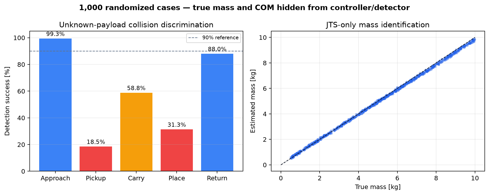
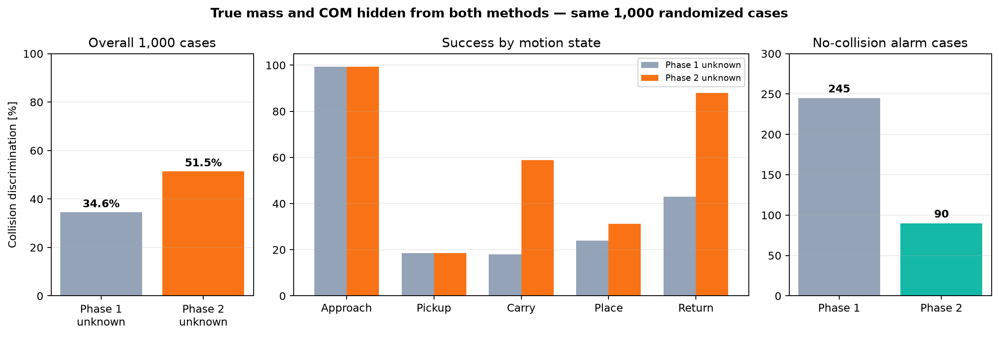

# 미지 질량·COM 조건 재검증

## 가정 수정

기존 2차 검출기는 실행마다 실제 `box_mass`, `box_com`을 제어기와 검출기에
전달했다. 값의 범위를 바꾸어 시험했지만 알고리즘은 그 값을 알고 있었으므로,
이를 "질량·COM 비공개 강건성"이라고 부를 수 없다.

수정안은 실제 질량과 COM을 plant 내부에만 둔다. `UNKNOWN_PAYLOAD=True`인
제어기와 검출기에는 `nom_box`, `box_mass`, `box_com` 속성을 만들지 않는다.
사용 입력은 모터측 각도, JTS, grip, 기준 궤적뿐이다.

## 센서 추가 없는 수정안

1. 집기 전 빈손 역동역학과 집기 후 JTS의 차이를 여러 자세에서 누적한다.
2. `theta=[m,m cx,m cy,m cz]` 중력 regressor를 최소제곱으로 식별한다.
3. 제어기는 식별 전에는 JTS에서 직접 본 하중을 완만하게 보상하고, 식별 뒤에는
   추정 payload 모델로 전환한다.
4. 검출기는 추정 질량을 절대 정답처럼 쓰지 않는다. 빈손 관측기 잔차의 100 ms
   이동 기준선을 만들고, 기준선보다 빠른 변화를 충돌 후보로 본다.
5. 집기 직후 300 ms는 payload 취득과 같은 방향 충돌을 추가 정보 없이 구분할
   수 없어 판정을 보류한다.

공구축 방향 COM은 이 궤적의 중력 데이터만으로 조건수가 나빠 0으로 고정했다.
질량과 수평 COM은 추정하지만, COM 전체를 정확히 식별했다고 주장하지 않는다.

## 1,000회 무작위 감사

- 질량: 0.5–10 kg, 알고리즘에는 비공개
- COM, 형상, 관성, 접촉 마찰, 작업대 강성·감쇠, 흡착 강성, 높이 오차,
  JTS 잡음·오프셋·드리프트, 로봇 마찰을 무작위화
- 충돌: 15–60 N, 무작위 3D 방향과 전 사이클 시각
- 각 조건에서 무충돌 기준 실행과 충돌 실행을 짝지어 정상 경보와 충돌 경보를
  구분

| 항목 | 결과 |
|---|---:|
| 충돌 구분 성공 | **515/1000 (51.5%)** |
| 미검출 | 442 |
| 충돌 전 경보 | 41 |
| 기준 실행과 경보 중첩 | 2 |
| 무충돌 기준 실행에서 경보가 난 조건 | 90/1000 (9.0%) |
| 성공 사례 검출 지연 중앙값 | 31.1 ms |
| 질량 추정 MAE | 0.086 kg |
| TCP RMS 오차 중앙값 | 5.52 mm |
| TCP 최대오차 95백분위 | 23.05 mm |
| 발산 | 0 |

| 동작 단계 | 성공/시험 | 성공률 |
|---|---:|---:|
| 시작·집기 접근 | 149/150 | 99.3% |
| 집기 천이 | 37/200 | **18.5%** |
| 운반 | 147/250 | **58.8%** |
| 놓기 천이 | 94/300 | **31.3%** |
| 복귀 | 88/100 | 88.0% |



## 동일 가정의 1차·2차 비교

기존 1차는 실제 질량·COM을 요구하므로 그대로는 공정 비교가 불가능하다. 비교용
1차-미지 기준안은 두 값을 숨기고 2차와 같은 JTS 추정 제어기를 사용하되,
1차의 짧은 천이창·5 ms 힘 크기 평균·기본 놓기 판정을 유지했다. 2차에서 추가한
확장 천이창, 예상 수직 접촉방향 제거, 20 ms 힘 벡터 평균은 사용하지 않았다.

| 동일 1,000조건 | 1차-미지 기준안 | 2차-미지 개선안 |
|---|---:|---:|
| 전체 충돌 구분 | 346/1000 (**34.6%**) | 515/1000 (**51.5%**) |
| 무충돌 경보 조건 | 245/1000 | 90/1000 |
| 시작·접근 | 99.3% | 99.3% |
| 집기 천이 | 18.5% | 18.5% |
| 운반 | 18.0% | 58.8% |
| 놓기 천이 | 24.0% | 31.3% |
| 복귀 | 43.0% | 88.0% |

2차는 **+16.9%p** 개선됐고 무충돌 경보 조건을 63.3% 줄였다. 개선은 주로
운반과 복귀에서 발생했다. 집기 천이는 두 안 모두 18.5%이므로, 미지 payload를
처음 취득하는 구간은 해결되지 않았다.



## 결론

질량 자체는 JTS로 비교적 잘 추정했지만, 그 사실만으로 충돌 검출 강건성이
확보되지는 않았다. 집기와 놓기에서는 정상 하중 변화와 충돌이 같은 센서 채널에
동시에 나타나며, 운반 중에도 미지 COM·관성과 모델 오차가 충돌 잔차와 겹친다.

따라서 기존 2차의 94.1%는 **payload 질량·COM이 설정된 조건의 결과**로만
유효하다. 질량·COM 비공개 조건의 현재 수정안은 51.5%이므로 최종 해결안으로
주장할 수 없다. 이 결과는 "추가 센서 없이 완전히 미지인 payload까지 해결했다"는
주장을 기각하는 반증이다.

다음 개선에는 다음 중 하나가 필요하다.

- 작업 시작 전 여러 자세의 짧은 payload 식별 동작
- 여러 사이클에서 정상 잔차 지도를 학습한 뒤 독립 시험 세트로 검증
- 속도·가속도까지 포함한 전체 관성 파라미터 식별
- 집기·놓기 천이 전용 변화점 검출기
- 외부 F/T 센서 또는 출력측 엔코더

## 재현

```bash
.venv/bin/python unknown_payload_audit.py --cases 1000 --workers 8
```

- 원자료: `results/unknown_payload/unknown_payload_1000.csv`
- 요약: `results/unknown_payload/summary.json`
- 공정 비교 원자료: `results/unknown_payload/phase1_vs_unknown_phase2_1000.csv`
- 공정 비교 요약: `results/unknown_payload/phase1_vs_unknown_phase2_summary.json`
