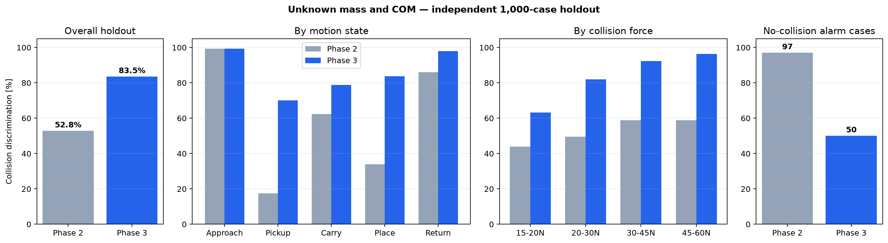

# 미지 질량·COM 3차 개선 보고서

## 출발점

기존 미지 2차는 최종 질량을 평균 0.09 kg 이내로 추정했지만, 집기 직후 300 ms
동안 충돌 판정을 완전히 껐다. 문제는 질량 추정 정확도보다 정상 하중 취득과
충돌을 같은 JTS 신호에서 즉시 분리하지 못한 것이었다.

## 검토한 연구 방향

- Gaz와 De Luca는 별도 F/T 센서 없이 제한된 작은 동작으로 미지 payload의
  동역학 파라미터를 식별해 충돌 검출 모델을 개선할 수 있음을 보였다
  ([IROS 2017 논문](https://www.diag.uniroma1.it/~labrob/pub/papers/IROS17_PayloadEstimation_2199.pdf)).
- 미지 payload 전용 연구에서는 모델 오차의 저주파 성분과 충돌의 빠른 성분을
  나누기 위해 band-pass torque observer를 사용했다
  ([Robot, 2020](https://robot.sia.cn/en/article/doi/10.13973/j.cnki.robot.190169)).
- 실제 산업용 로봇 연구들은 고정 문턱보다 궤적과 속도에 따른 시간가변 문턱이
  모델 오차로 인한 경보를 줄인다고 보고한다
  ([ASME 2021](https://doi.org/10.1115/1.4048782),
  [Sensors 2017](https://www.mdpi.com/1424-8220/17/5/1148)).
- 일반화 운동량 관측기의 실무 검토에서는 빠른 충돌과 느린 접촉을 서로 다른
  필터로 보는 다중 관측기 구조를 소개한다
  ([Practical Aspects of Model-Based Collision Detection](https://pmc.ncbi.nlm.nih.gov/articles/PMC7805958/)).

## 선택한 3차 구조

제어기는 유지했다. 기존 JTS 기반 제어기의 질량 MAE와 추종 안정성이 이미
좋았으므로 이번 병목은 관측기로 판단했다.

1. **Payload nuisance subspace:** 질량과 COM 숫자는 몰라도 payload 중력 토크가
   `Y(q)[m, m·cx, m·cy, m·cz]`의 4차원 공간에 존재한다는 구조는 안다. 집기
   초기에는 이 공간만 제거하고 나머지 방향의 충돌을 계속 감시한다.
2. **정상 전용 시간 프로필:** 충돌이 없는 300개 미지 물체 실행으로 각 1 ms
   시각의 6축 잔차 중앙값과 99.5백분위 범위를 학습했다. 충돌 데이터와 최종
   holdout 데이터는 학습하지 않았다.
3. **동적 문턱:** 정상 범위에 50% 여유와 ±8 ms 시간 여유를 주고, 최근 20 ms
   중 5회 초과해야 경보로 확정한다.
4. **감지 공백 제거:** 기존의 집기 직후 300 ms 강제 판정 보류를 제거했다.

사용 센서는 기존과 동일한 모터측 각도, JTS, grip 신호다. 실제 질량·COM은
plant에만 존재하며 제어기와 검출기에 전달하지 않았다.

## 데이터 분리

| 용도 | 정상 실행 수 | 난수 seed | 충돌 데이터 사용 |
|---|---:|---:|---:|
| 정상 프로필 학습 | 300 | 73129 | 없음 |
| 개발·문턱 확인 | 100 | 777 | 평가에만 사용 |
| 최종 독립 시험 | 1,000 | 20261201 | 평가에만 사용 |

## 독립 1,000조건 결과

| 항목 | 기존 미지 2차 | 새 3차 | 변화 |
|---|---:|---:|---:|
| 전체 충돌 구분 | 528/1000 (**52.8%**) | 835/1000 (**83.5%**) | **+30.7%p** |
| 무충돌 경보 조건 | 97/1000 | 50/1000 | 47개 감소 |
| 집기 천이 | 17.5% | **70.0%** | +52.5%p |
| 운반 | 62.4% | **78.8%** | +16.4%p |
| 놓기 천이 | 34.0% | **83.7%** | +49.7%p |
| 복귀 | 86.0% | **98.0%** | +12.0%p |
| 검출 지연 중앙값 | 31.6 ms | 33.7 ms | +2.1 ms |
| 발산 | 0 | 0 | 동일 |



힘별 3차 성공률은 15–20 N 63.2%, 20–30 N 82.0%, 30–45 N 92.4%,
45–60 N 96.4%였다. 남은 실패 165개는 미검출 154개와 충돌 전 경보 11개다.
약한 충돌과 집기 구간이 여전히 가장 어렵다.

## 해석과 한계

3차는 추가 센서 없이 독립 시험에서 큰 개선을 보였지만 범용 해결은 아니다.
시간 프로필은 현재 6초 팔레타이징 궤적에 묶여 있다. 궤적, 속도, 공구 또는
환경 범위가 크게 달라지면 정상 프로필을 다시 수집해야 한다. 또한 15–20 N의
성공률 63.2%는 낮으므로 사람 안전용 최종 기능으로 바로 사용할 수준은 아니다.

다음 개선 우선순위는 다음과 같다.

1. 궤적 시간 대신 `q, qd, qdd, grip`을 입력으로 정상 잔차 범위를 예측해 다른
   궤적으로 일반화한다.
2. 빠른 band-pass 채널과 느린 payload 식별 채널을 병렬화해 약한 충돌 감도를
   높인다.
3. 집기 직후 50–100 ms의 작은 식별 흔들기 동작을 제어기에 넣은 안과 생산성·
   안전성의 절충을 비교한다.
4. 실제 M1013 로그로 정상 프로필을 재학습하고 시뮬레이션-실기 차이를 검증한다.

## 재현

```bash
.venv/bin/python train_unknown_normal_profile.py --cases 300 --seed 73129 --workers 8
.venv/bin/python unknown_payload_holdout_audit.py --cases 1000 --seed 20261201 --workers 8
.venv/bin/python unknown_payload_v3_audit.py --cases 1000 --seed 20261201 --workers 8
.venv/bin/python analyze_unknown_v3.py
```

- 학습 프로필: `results/unknown_payload_v3/normal_profile.npz`
- 기존 holdout 원자료: `results/unknown_payload_holdout/unknown_payload_1000.csv`
- 3차 holdout 원자료: `results/unknown_payload_v3/unknown_payload_1000.csv`
- 비교 요약: `results/unknown_payload_v3/phase2_vs_phase3_holdout_summary.json`
